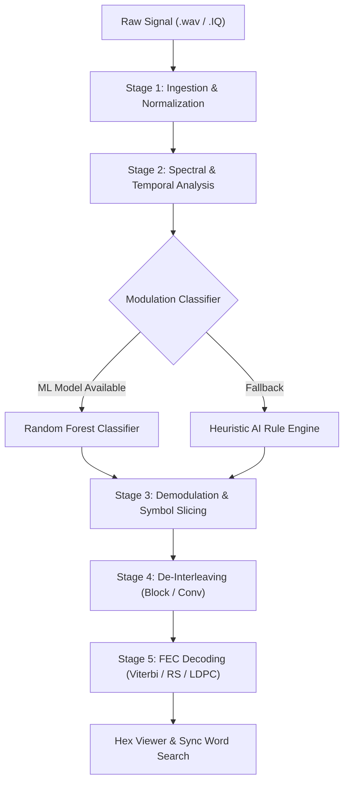

# SignalForge — Automated Signal Analysis Workbench

[](https://www.python.org/downloads/)
[](https://pypi.org/project/PyQt6/)
[](LICENSE)
[](#)

> **SignalForge** is an offline, high-performance, GUI-based signal intelligence and digital communications analysis workbench designed for automated raw RF signal ingestion, spectral analysis, modulation recognition, symbol demodulation, de-interleaving, and forward error correction (FEC) decoding.

---

## Table of Contents
- [Overview](#overview)
- [Key Features](#key-features)
- [System Architecture & 5-Stage Pipeline](#system-architecture--5-stage-pipeline)
- [Supported Formats & Schemes](#supported-formats--schemes)
- [Installation & Setup](#installation--setup)
- [Quick Start Guide](#quick-start-guide)
- [Project Structure](#project-structure)
- [Machine Learning & DSP Engine](#machine-learning--dsp-engine)
- [Theme Customization](#theme-customization)
- [Contributing](#contributing)

---

## Overview

Off-the-air signal collection across RF spectra (kHz to GHz) typically yields unlabelled raw `.IQ` and `.wav` captures. Analyzing these files manually to discern symbol rates, carrier frequencies, modulation formats, interleaving depths, and FEC matrices is tedious and error-prone.

**SignalForge** automates this workflow end-to-end:
1. **Ingests** varied complex IQ and real-valued audio/RF files.
2. **Visualizes** signals instantly with interactive power spectral density (PSD), waterfall spectrograms, and constellation diagrams.
3. **Identifies** the modulation class automatically through ML-driven statistical feature extraction (with an intelligent heuristic fallback).
4. **Demodulates** the signal using carrier/clock synchronization loops (Costas loop, RRC filter, frequency discriminator).
5. **Decodes & De-interleaves** bitstreams, rendering the result in a live interactive hex viewer with sync word correlation.

---

## Key Features

### 1. Robust File Ingestion
- Native support for standard `.wav` PCM audio/RF captures.
- Native ingestion of raw binary `.IQ` files with selectable encodings: `complex64`, `int16`, `int8`, and `uint8`.
- In-memory conversion to normalized `complex64` arrays with automatic DC offset removal.

### 2. Real-Time Spectral & Constellation Visualization
- **Power Spectral Density (PSD)**: Welch periodogram with configurable FFT size, dB scale, and peak frequency estimation.
- **Time-Frequency Waterfall**: High-speed dynamic spectrogram with colormap rendering.
- **Constellation Diagram**: Real-time I/Q scatter plot with downsampling for fluid frame rates.
- **Dynamic Theming**: One-click toggle between optimized Dark and Light themes with adaptive plot backgrounds and coordinate grids.

### 3. Automatic Modulation Recognition (AMR)
- **Random Forest Classifier**: Trained on hand-crafted high-order statistical moments and spectral cumulants:
  - Normalized instantaneous amplitude variance ($\sigma_{aa}$)
  - Spectral kurtosis & skewness
  - Maximum power spectral density of normalized instantaneous frequency ($\gamma_{max}$)
  - Higher-order cumulants ($C_{40}$, $C_{42}$)
- **Heuristic AI Fallback**: Self-contained rule-based classifier that functions out-of-the-box even without pre-trained model checkpoints.

### 4. Demodulation & Clock Recovery
- **BPSK**: Costas carrier recovery loop + matched Root-Raised Cosine (RRC) filtering.
- **QPSK**: 4-phase decision-directed carrier tracking and constellation slicing.
- **FSK (2-FSK / 4-FSK)**: Non-coherent quadrature frequency discriminator with peak thresholding.
- **16-QAM**: In-phase and quadrature grid decider with symbol-to-bit mapping.

### 5. De-Interleaving & Channel Coding (FEC)
- **De-Interleaving**: Configurable Block matrix (rows $\times$ columns) and Convolutional shift-register de-interleavers.
- **Forward Error Correction**:
  - Viterbi Soft/Hard-decision Convolutional decoding ($K=7$, rate $1/2$).
  - Reed-Solomon (RS) algebraic block decoding.
  - Concatenated code processing pipeline.
  - LDPC decoding framework.

### 6. Bitstream Inspection & Pattern Correlation
- Live Hex & ASCII viewer with offset index tracking.
- Sync Word / Preamble hunter (e.g., `0xEB90`, `0x1ACFFC1D`) for frame alignment and payload boundary extraction.
- Export decoded bitstream to raw binary or text.

---

## System Architecture & 5-Stage Pipeline

SignalForge separates DSP compute from UI interaction using a multi-threaded architecture (`QThread`), guaranteeing zero interface stuttering during heavy FFT or demodulation computations.



---

## Supported Formats & Schemes

| Domain | Supported Schemes / Formats |
| :--- | :--- |
| **Input Files** | `.wav` (PCM 16/24/32-bit), `.iq` / `.raw` / `.bin` (`complex64`, `int16`, `int8`, `uint8`) |
| **Modulation** | BPSK, QPSK, 2-FSK, 4-FSK, 16-QAM, 8-PSK |
| **De-Interleaving** | Block Interleaver (Row-Column swap), Convolutional Interleaver |
| **FEC / Channel Coding** | Viterbi ($R=1/2$, Poly `[0o171, 0o133]`), Reed-Solomon ($n, k$), Concatenated RS + Viterbi, LDPC |
| **Analysis** | FFT / PSD, Waterfall Spectrogram, I/Q Constellation, Bit Error Rate (BER) ground-truth test |

---

## Installation & Setup

### Prerequisites
- Python **3.10+** (Tested on Python 3.10, 3.11, 3.12, 3.13)
- Windows, macOS, or Linux

### 1. Clone the Repository
```bash
git clone https://github.com/YashChindhe/SignalForge.git
cd SignalForge
```

### 2. Set Up a Virtual Environment
```bash
# Windows
python -m venv venv
venv\Scripts\activate

# macOS / Linux
python3 -m venv venv
source venv/bin/activate
```

### 3. Install Dependencies
```bash
pip install --upgrade pip
pip install -r requirements.txt
```

---

## Quick Start Guide

### Run the Application
Launch the graphical workbench directly:
```bash
python run.py
```

### Generate Synthetic Test Signals
Generate clean and noisy test signals with known ground-truth bit sequences for verification:
```bash
python scripts/generate_test_signals.py
```
This generates:
- BPSK, QPSK, 2FSK, 4FSK, 16QAM signals in `data/test_signals/` across multiple SNR levels (0 dB to 40 dB).
- Associated `*_bits.npy` ground-truth bitstreams to measure receiver Bit Error Rate (BER).

### Train the ML Classifier (Optional)
If you have the **RadioML 2018.01A** dataset:
```bash
python scripts/train_classifier.py
```
This extracts statistical features, trains a Random Forest model, and serializes the model artifacts into `models/`. *(Note: If model files are absent, SignalForge automatically engages its built-in Heuristic AI classifier).*

---

## Project Structure

```
SignalForge/
├── assets/
│   └── styles/
│       ├── dark_theme.qss            # Modern dark stylesheet
│       └── light_theme.qss           # Modern light stylesheet
├── CommonDocumentation/              # Architecture, PRD, and design docs
│   ├── 26147.md
│   ├── architecture.md
│   ├── design.md
│   ├── memory.md
│   ├── phases.md
│   ├── prd.md
│   └── rules.md
├── data/
│   └── test_signals/                 # Synthetic IQ / WAV signals & ground truth
├── scripts/
│   ├── generate_test_signals.py      # Test signal generator
│   └── train_classifier.py           # RadioML training script
├── src/
│   ├── core/                         # DSP and ML engine
│   │   ├── bitstream.py              # Hex conversion & sync word search
│   │   ├── classifier.py             # Random Forest classifier wrapper
│   │   ├── deep_learning.py          # 1D-CNN architecture prototype
│   │   ├── deinterleave/             # Block & Convolutional de-interleavers
│   │   ├── demodulators/             # BPSK, QPSK, FSK, QAM demodulators
│   │   ├── features.py               # Statistical cumulant & moment extractor
│   │   ├── fec/                      # Viterbi, RS, Concatenated, LDPC decoders
│   │   ├── file_ingest.py            # WAV and binary IQ loaders
│   │   ├── heuristic.py              # Heuristic AI classifier fallback
│   │   ├── pipeline.py               # 5-stage pipeline coordinator
│   │   └── spectral.py               # FFT, PSD, and spectrogram logic
│   ├── gui/                          # PyQt6 user interface
│   │   ├── main_window.py            # Main application window
│   │   ├── threads/                  # Background worker QThreads
│   │   └── widgets/                  # Modular UI panels & graph widgets
│   └── utils/
│       └── logger.py                 # Structured logging utility
├── .gitignore
├── requirements.txt
└── run.py                            # Application entry point
```

---

## Machine Learning & DSP Engine

SignalForge employs a dual-engine architecture:
- **Feature Extraction**: Computes instantaneous amplitude, frequency, and phase statistics ($C_{20}, C_{21}, C_{40}, C_{41}, C_{42}, \sigma_{aa}, \sigma_{af}$).
- **Random Forest Model**: Fast inference with sub-millisecond execution times and high classification accuracy on signals with SNR $\ge$ 5 dB.
- **DSP Carrier & Timing Sync**:
  - Phase-locked loops (Costas loop) for continuous carrier phase tracking.
  - Root-Raised Cosine (RRC) matched filter to minimize Inter-Symbol Interference (ISI).
  - Frequency discriminator for M-ary FSK tones.

---

## Theme Customization

SignalForge includes a dedicated theme engine that dynamically switches between **Dark Mode** and **Light Mode**:
- Toggled via the top menu bar: **Theme $\rightarrow$ Toggle Light/Dark Mode**.
- Updates PyQt6 control stylesheets and dynamically re-paints all internal plot curves, coordinate axes, backgrounds, and grids without restarting the application.

---

## Contributing

Contributions, bug reports, and enhancements are welcome!
1. Fork the repository.
2. Create your feature branch (`git checkout -b feature/dsp-enhancement`).
3. Commit your changes (`git commit -m "Add polyphase filter bank"`).
4. Push to the branch (`git push origin feature/dsp-enhancement`).
5. Open a Pull Request.

---

## License

This project is distributed under the MIT License. See [LICENSE](LICENSE) for details.
